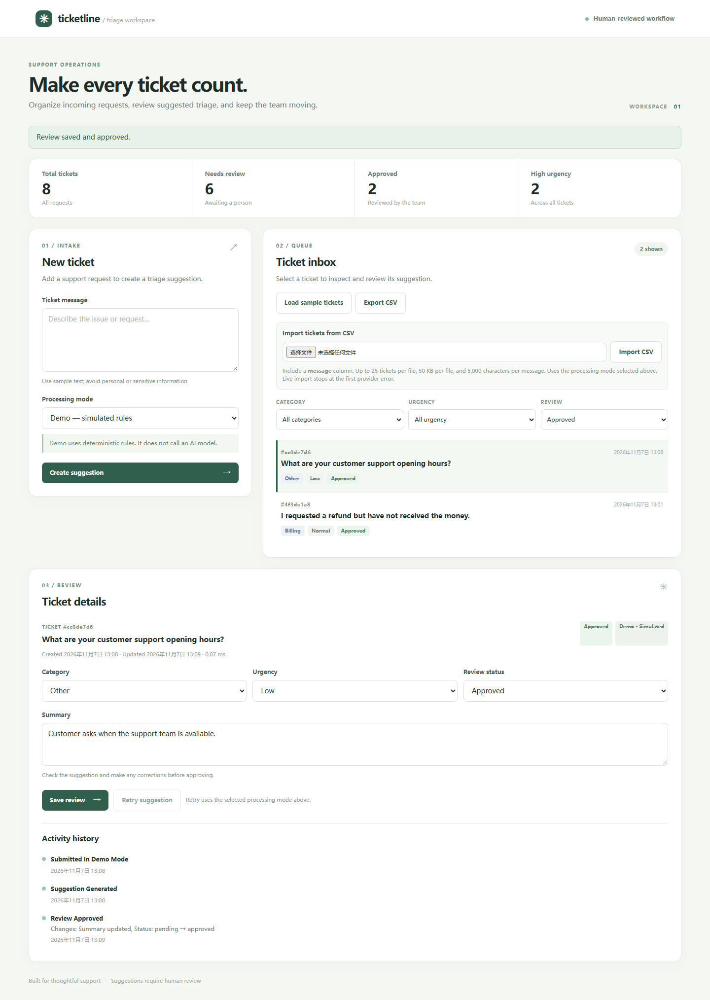
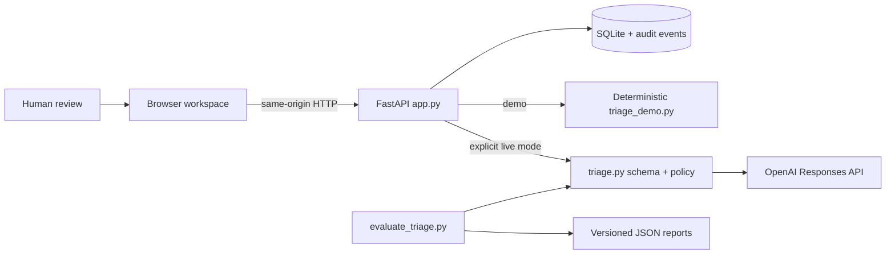

# Ticketline — AI support ticket triage

A working support review application built with **FastAPI, SQLite, Pydantic and plain JavaScript**. Submit or import tickets, generate a category/urgency/summary suggestion, correct it, approve it, and inspect the history. Original suggestions remain available after review.

**Try it without credentials:** the explicitly labeled demo mode uses deterministic rules. **Live mode:** the server calls the OpenAI Responses API using schema-constrained output. The browser never receives or asks for the provider API key.



[Architecture](docs/ARCHITECTURE.md) · [Demo and deployment](docs/DEMO.md) · [Evaluation methodology](docs/EVALUATION.md) · [Portfolio notes](docs/PORTFOLIO.md)

## Run locally

Python 3.13 is the verified development environment. From the repository folder:

```powershell
python -m venv .venv
.\.venv\Scripts\python.exe -m pip install -r requirements-lock.txt
.\.venv\Scripts\python.exe run_server.py
```

Open **http://127.0.0.1:8000**. Click **Load sample tickets**, select a ticket, edit its suggestion, and save it as approved. SQLite persists the data between restarts. The prepared Desktop checkout already contains its environment; only the last command is needed there.

On macOS/Linux, use `.venv/bin/python` in place of `.\.venv\Scripts\python.exe`.

To enable live inference, stop the server and launch:

```powershell
.\.venv\Scripts\python.exe run_server.py --live
```

The terminal asks privately for the API key if `OPENAI_API_KEY` is not already set. It keeps the key only in the server process environment. In the browser, deliberately select **Live AI** before submission. Each live ticket makes one provider request, with no automatic retries. The demo mode sends none.

Use `--protect` to privately set a workspace access token. This token protects the workspace and is different from the provider key:

```powershell
.\.venv\Scripts\python.exe run_server.py --live --protect
```

The login uses an HttpOnly, SameSite=Strict cookie. Header-based API clients may use `X-Access-Token` or a bearer workspace token. The application is designed for one operator or a trusted shared workspace; it does not implement independent user accounts or tenant isolation.

## Working capabilities

- Interactive intake and a persistent ticket inbox, with category/urgency/review filters and overview counts.
- Structured suggestions validated against allowed categories and urgency levels.
- Human correction and approval; immutable original suggestion plus append-only application history.
- Failed suggestions remain visible; explicit retry claims prevent two retries from processing the same failed record simultaneously.
- Interrupted in-progress records become retryable on restart.
- CSV import (`message` column; at most 25 tickets per batch), validation before writes, and CSV export with spreadsheet formula escaping.
- Live import stops after the first provider failure, reports remaining tickets, and retains completed results.
- Server-side provider credentials; optional workspace access gate; rejection of cross-origin changes; bounded messages and request bodies.
- Reusable CLI classifiers and evaluation tools retained from the project's learning stages.
- JSON evaluation reports with per-category metrics, confusion matrices, failures, latency percentiles, usage, and implementation/prompt/dataset hashes.

Import `data/sample_tickets.csv` to try batch intake. A CSV can be at most 50 KB in the browser; the JSON request limit is 64,000 bytes. Ticket text is limited to 5,000 characters. The browser reports oversized encoded requests before sending them.

## Architecture



The UI is served from `static/`. `app.py` validates requests and coordinates triage and review; `storage.py` owns database transactions. `triage.py` contains the live schema and teaching policy. `triage_demo.py` is a simulation, not a replacement for measured AI quality.

| Path | Purpose |
| --- | --- |
| `app.py`, `storage.py`, `run_server.py` | Web API, SQLite persistence, and safe-default launch |
| `static/` | Dashboard and local API reference |
| `triage.py`, `triage_demo.py` | Live structured inference and deterministic simulation |
| `evaluate_triage.py`, `data/triage_*.jsonl` | Reproducible development/holdout evaluations |
| `tests/` | Offline application, SDK integration, and evaluation checks |
| `reports/` | Measured reports and historical development observation |
| `docs/` | Architecture, deployment, walkthrough and portfolio evidence |
| `classifier.py`, `evaluate.py`, `ticket_classifier*.py` | Earlier category-only CLI stages |
| `REBUILD_EXERCISES.md` | Optional exercises for the earlier CLI learning stages |

## API reference

Open **http://127.0.0.1:8000/docs** for the local endpoint reference, or `/openapi.json` for the full schema. This reference uses local assets so it works with the content security policy and without third-party CDN access.

| Method and path | Behavior |
| --- | --- |
| `GET /health`, `GET /api/config` | Public health and non-secret configuration |
| `POST /api/session`, `POST /api/session/logout` | Workspace sign-in and sign-out |
| `GET /api/tickets`, `GET /api/tickets/{id}` | List or inspect saved tickets and history |
| `POST /api/tickets` | Submit `{message, mode}` and persist the suggestion or failure |
| `PATCH /api/tickets/{id}` | Correct category/urgency/summary and set review status |
| `POST /api/tickets/{id}/retry` | Retry an errored ticket using a chosen mode |
| `POST /api/tickets/import` | Import `{csv, mode}` with a message-column CSV |
| `POST /api/demo/seed` | Add three examples to an empty inbox |
| `GET /api/stats`, `GET /api/export.csv` | Overview counts and full ticket export |

## Verification

```powershell
.\.venv\Scripts\python.exe -m unittest discover -s tests -v
node --check static/app.js
node --check static/api-docs.js
.\.venv\Scripts\python.exe evaluate_triage.py --mode demo --split development
```

The offline tests cover application persistence, approval/audit history, validation, session/header access, Unicode tokens, failed inference and retry, concurrent retry claims, interrupted processing recovery, CSV validation and escaping, SDK schema parsing with a simulated transport, and evaluation failure accounting. They make no model requests. GitHub Actions runs these checks and a container smoke test.

Browser verification covered ticket creation, review/approval, filtering, persistence after refresh, import/export, and responsive rendering. A recorded deterministic demonstration is in `docs/assets/ticketline-walkthrough.webm`.

## Evaluation evidence

The fixed datasets contain **30 development and 30 separate holdout examples**, manually reviewed and synthetic. These labels follow the project's documented teaching urgency policy. Holdout data was not used to adjust the implemented demo rules.

| Implementation and split | Category correct | Urgency correct | Both correct |
| --- | ---: | ---: | ---: |
| Keyword/constant-urgency baseline — holdout | 13/30 | 13/30 | 4/30 |
| Deterministic demo — development | 25/30 | 19/30 | 16/30 |
| Deterministic demo — holdout | 23/30 | 13/30 | 8/30 |
| Live structured AI — holdout | Not run | Not run | Not run |

These are **simulation/baseline results, not AI accuracy claims**. The poor demo urgency result is deliberately retained as a visible limitation. Category/urgency accuracy does not measure summary factuality. The earlier user-observed `9/9` result in `reports/development-comparison.json` covers only the original category classifier on nine known development examples.

To measure the live structured model on the fixed holdout after configuring credentials:

```powershell
.\.venv\Scripts\python.exe evaluate_triage.py --mode live --split holdout
```

This can send up to 30 paid requests. Reports retain failed/unattempted cases in the denominator. Authentication failure stops further requests. Token usage is counted only when returned, and dollar cost is `null` because no verified price schedule is supplied. Live holdout results and summary-quality measurements have not been fabricated.

## Deployment and operating scope

`run_server.py` defaults to loopback. For network exposure, set `TRIAGE_HOST` and a strong `TRIAGE_ACCESS_TOKEN`; the launcher refuses a non-loopback bind without one. Use HTTPS through your hosting platform/reverse proxy and configure `TRIAGE_EXTERNAL_ORIGIN` to its exact public origin, such as `https://your-service.example.com`. This provides the browser origin and secure-cookie policy without blindly trusting proxy headers.

Settings are documented in `.env.example`; the file is an example and is **not automatically loaded**. Store real secrets in process environment variables or your hosting secret manager. Database files, environments, and secret files are excluded from Git.

A non-root Dockerfile and persistent-volume configuration are included. See [the deployment guide](docs/DEMO.md) for Docker commands and an unverified managed-hosting path. A public cloud deployment has not been performed. SQLite runs on one host; this release is not a multi-tenant helpdesk or a horizontally scaled service. Shared-token logout clears the browser session; rotating the configured token invalidates all sessions.

## Project evidence and ownership

This is an AI-assisted learning and portfolio project. The code, automated checks, measured reports, architecture, limitations, and demo are available for inspection. It contains no claims of external customers, business savings, or production-scale adoption. A developer presenting the work should be able to trace a request, explain the policy, reproduce a failure, and modify and test the application.

MIT licensed. See [LICENSE](LICENSE).
